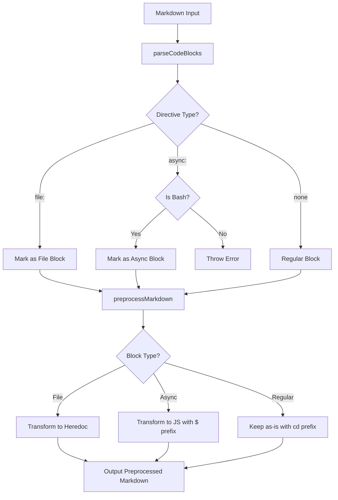

# Async Directive Feature Plan

## Overview

Add support for explicit directives in blockquote syntax:
- `file:` - for file extraction (breaking change: now mandatory)
- `async:` - for asynchronous bash block execution

## Requirements

1. **Breaking change**: `file:` prefix becomes mandatory for file extraction
2. **Async blocks**: Fire-and-forget using `$`command`` (zx awaits all promises at end)
3. **Async validation**: Only works with bash blocks, error out for non-bash
4. **Backticks optional**: Support both `> file: path.ts` and `> file: `path.ts``

## Syntax Examples

### File Directive (breaking change)

```markdown
<!-- OLD syntax (no longer supported) -->
> `package.json`

<!-- NEW syntax (required) -->
> file: `package.json`

<!-- Also valid -->
> file: package.json
```

### Async Directive (new)

```markdown
> async: `start server`
```bash
npm run dev
```

> async: start background process
```bash
sleep 10 && echo "done"
```
```

The text after `async:` is descriptive only - for user documentation.

## Architecture



## Implementation Details

### 1. Update Directive Parsing

**File:** `src/preprocessor.ts`

Replace `extractFilePathFromBlockquote()` with `extractDirectiveFromBlockquote()`:

```typescript
interface Directive {
  type: 'file' | 'async';
  value: string; // file path for 'file', description for 'async'
}

function extractDirectiveFromBlockquote(line: string): Directive | null {
  const trimmed = line.trim();
  
  // Match: > file: `path` OR > file: path
  const fileMatch = trimmed.match(/^>\s*file:\s*(?:`([^`]+)`|(\S+.*))\s*$/i);
  if (fileMatch) {
    return {
      type: 'file',
      value: (fileMatch[1] || fileMatch[2]).trim()
    };
  }
  
  // Match: > async: `description` OR > async: description
  const asyncMatch = trimmed.match(/^>\s*async:\s*(?:`([^`]*)`|(.*))?\s*$/i);
  if (asyncMatch) {
    return {
      type: 'async',
      value: (asyncMatch[1] || asyncMatch[2] || '').trim()
    };
  }
  
  return null;
}
```

### 2. Update CodeBlock Interface

```typescript
export interface CodeBlock {
  language: string;
  content: string;
  startLine: number;
  endLine: number;
  filePath?: string;           // For file: directive
  isAsync?: boolean;           // For async: directive
  asyncDescription?: string;   // Optional description from async: directive
  precedingBlockquoteLine?: number;
}
```

### 3. Update parseCodeBlocks()

Modify to detect and validate directives:

```typescript
// In parseCodeBlocks()
const directive = extractDirectiveFromBlockquote(line);
if (directive) {
  precedingBlockquoteLine = i;
  if (directive.type === 'file') {
    pendingFilePath = directive.value;
    pendingAsync = false;
  } else if (directive.type === 'async') {
    pendingAsync = true;
    pendingAsyncDescription = directive.value;
    pendingFilePath = undefined;
  }
}

// When starting a code block
if (!inCodeBlock) {
  const languageMatch = line.match(/^```(\w*)/);
  const language = languageMatch?.[1] || '';
  
  // Validate async only works with bash
  if (pendingAsync && !isBashLanguage(language)) {
    throw new Error(
      `async: directive can only be used with bash/sh/shell blocks. ` +
      `Found: ${language || 'no language specified'} at line ${i + 1}`
    );
  }
  
  currentBlock = {
    language,
    filePath: pendingFilePath,
    isAsync: pendingAsync,
    asyncDescription: pendingAsyncDescription,
    precedingBlockquoteLine,
    content: '',
    startLine: i,
  };
}
```

### 4. Transform Async Blocks

In `preprocessMarkdown()`, handle async blocks:

```typescript
// Check if this is an async block
if (block.isAsync) {
  // Transform bash to JS with $ template
  const bashCommand = block.content.trim();
  // Escape backticks in the command
  const escapedCommand = bashCommand.replace(/`/g, '\\`');
  
  // Build JS code - just fire the command without await
  // Include directory prefix if needed
  const cdPrefix = currentDirectory ? `cd ${currentDirectory} && ` : '';
  const jsCode = `$\`${cdPrefix}${escapedCommand}\``;
  
  blocksToAsyncTransform.set(i, jsCode);
  continue;
}
```

When building output:

```typescript
if (blocksToAsyncTransform.has(blockIndex)) {
  const jsCode = blocksToAsyncTransform.get(blockIndex)!;
  preprocessedLines.push('```js');
  preprocessedLines.push(jsCode);
  preprocessedLines.push('```');
  i = block.endLine;
  continue;
}
```

### 5. Error Messages

Provide clear, actionable error messages:

```typescript
throw new Error(
  `[ezx] async: directive error at line ${lineNumber}\n` +
  `The async: directive can only be used with bash, sh, or shell code blocks.\n` +
  `Found: \`\`\`${language}\n` +
  `\n` +
  `To fix this, either:\n` +
  `1. Change the code block language to bash/sh/shell\n` +
  `2. Remove the async: directive from the preceding blockquote`
);
```

## File Changes Summary

| File | Changes |
|------|---------|
| `src/preprocessor.ts` | Replace `extractFilePathFromBlockquote()` with `extractDirectiveFromBlockquote()`, update interfaces, add async transformation logic |
| `src/index.ts` | No changes needed - preprocessor handles everything |
| `README.md` | Document new syntax, note breaking change |
| `AGENTS.md` | Update directive documentation |
| `TEST.md` | Update to use `file:` prefix |
| `TEST3.md` | Already has async example - update to use `async:` prefix |
| `test-comprehensive.md` | Update examples |

## Migration Guide for Breaking Change

### Before (no longer works)
```markdown
> `package.json`
```json
{"name": "test"}
```
```

### After (required)
```markdown
> file: `package.json`
```json
{"name": "test"}
```
```

Or without backticks:
```markdown
> file: package.json
```json
{"name": "test"}
```
```

## Test Cases

### Test 1: Basic async execution
```markdown
> async: start background task
```bash
sleep 2 && echo "async done"
```

```bash
echo "this runs immediately"
```
```

Expected: "this runs immediately" prints first, "async done" prints 2 seconds later.

### Test 2: Async with directory context
```markdown
```bash
# set the current directory
cd my-project
```

> async: background in project dir
```bash
sleep 1 && pwd
```
```

Expected: pwd shows my-project directory.

### Test 3: Error on non-bash async
```markdown
> async: this should fail
```typescript
console.log("test")
```
```

Expected: Error message explaining async only works with bash.

### Test 4: File with explicit directive
```markdown
> file: test.json
```json
{"key": "value"}
```
```

Expected: Creates test.json with the content.

## Open Questions

1. Should we add a `--strict` flag to make the migration easier? (warn vs error for old syntax)
2. Should async blocks show any output prefix like `[async]` to help debugging?