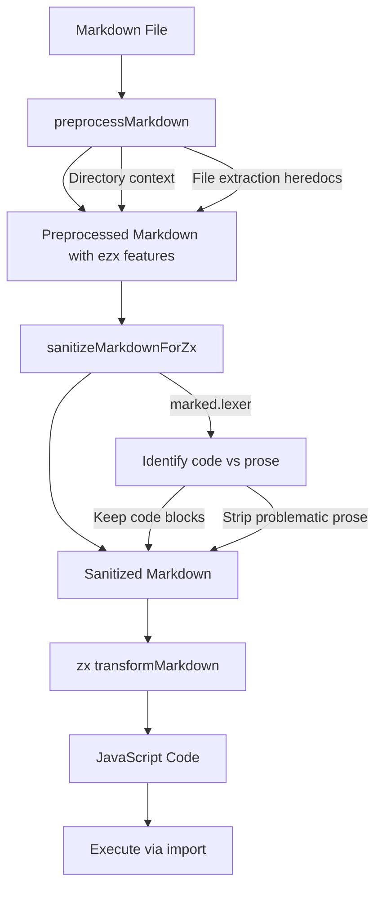

# Plan: Fix Markdown Parsing with Preprocessing Sanitization

## Problem

zx's `transformMarkdown` uses regex-based parsing that incorrectly treats indented text (like list item continuations) as code blocks. This causes errors like `"Unexpected identifier 'assumes'"` when markdown contains indented prose.

**Root cause in zx (lines 65-76 of cli.cjs):**
```javascript
const tabRe = /^(  +|\t)/;  // Matches 2+ spaces or tab
// ...
if (tabRe.test(line) && prevLineIsEmpty) {
  output.push(line);  // Treated as CODE, not text!
  state = "tab";
}
```

## Solution

**Preprocess markdown to sanitize it before passing to zx's `transformMarkdown`**

Instead of replacing zx's transformation entirely, we use a markdown parser to:
1. Identify what's a code block vs prose
2. Sanitize the prose so zx won't misinterpret it
3. Keep code blocks exactly as-is
4. Pass the "cleaned" markdown to zx's existing `transformMarkdown`

This approach:
- **Keeps zx's battle-tested transformation logic** for bash/js
- **Uses marked as a filter** only to identify content types
- **Minimal code changes** - adds sanitization step to existing preprocessor
- **Lower risk** - zx's code block handling remains unchanged

## Implementation Steps

### 1. Add `marked` dependency
```bash
pnpm add marked
```

### 2. Update `src/preprocessor.ts`

Add a sanitization function that:
1. Uses `marked.lexer()` to parse the markdown
2. Rebuilds the markdown with:
   - Code blocks preserved exactly as-is
   - Non-code content stripped of problematic indentation

```typescript
import { marked } from 'marked';

/**
 * Sanitize markdown to prevent zx's parser from misinterpreting
 * indented prose as code blocks.
 *
 * zx treats lines starting with 2+ spaces after an empty line as code.
 * We use marked to identify actual code blocks and strip/normalize
 * everything else.
 */
export function sanitizeMarkdownForZx(markdown: string): string {
  const tokens = marked.lexer(markdown);
  const output: string[] = [];

  for (const token of tokens) {
    if (token.type === 'code') {
      // Keep fenced code blocks exactly as-is
      const fence = '```';
      output.push(`${fence}${token.lang || ''}`);
      output.push(token.text);
      output.push(fence);
      output.push(''); // Empty line after
    } else if (token.type === 'heading') {
      // Keep headings (useful for section extraction)
      output.push(`${'#'.repeat(token.depth)} ${token.text}`);
      output.push('');
    } else if (token.type === 'space') {
      // Keep empty lines but limit to one
      output.push('');
    }
    // Other content (paragraphs, lists, blockquotes, etc.) is dropped
    // since it's not executable and could confuse zx
  }

  return output.join('\n');
}
```

### 3. Integrate into preprocessing pipeline

Update `src/index.ts` to sanitize before calling zx's transform:

```typescript
import {transformMarkdown} from 'zx/cli';
import {preprocessMarkdown} from './preprocessor.js';

// In runMarkdown():
const {preprocessedMarkdown} = preprocessMarkdown(markdownContent, {...});

// NEW: Sanitize to prevent zx misinterpretation
const sanitizedMarkdown = sanitizeMarkdownForZx(preprocessedMarkdown);

// Then use zx's transform as before
let jsCode = transformMarkdown(sanitizedMarkdown);
```

### 4. Edge Case: Indented Code Blocks in Lists

TEST2.md contains code blocks **indented within list items**:

```markdown
- on localhost

  ```bash            <-- Fence indented with 2 spaces
  pnpm run contracts:deploy localhost
  ```                <-- Closing also indented

- [pnpm](https://pnpm.io/)

  ```bash            <-- Another indented code block
  npm i -g pnpm
  ```
```

**Why `marked` is required (not optional):**

A simple regex approach would fail because:
- Fence detection `/^```/` wouldn't match `  ```bash` (2-space indent)
- Need to track indentation level per block
- Need to strip same indentation from fence, content, AND closing fence
- Edge cases with nested structures

`marked` handles this automatically:
- Correctly parses indented code blocks within list structures
- Returns code tokens with content already de-indented
- We simply rebuild as top-level (non-indented) code blocks

**The simple regex approach is NOT suitable for this project.**

## Architecture Diagram



## Benefits

1. **Minimal changes**: Uses zx's existing transformer
2. **Low risk**: Code block handling is unchanged
3. **Handles indented code blocks**: Properly parses code within list items
4. **Robust**: Uses battle-tested markdown parser

## Files to Modify

1. `package.json` - Add `marked` dependency
2. `src/preprocessor.ts` - Add `sanitizeMarkdownForZx` function (or integrate into existing `preprocessMarkdown`)
3. `src/index.ts` - Call sanitize before zx's transformMarkdown

## Summary

Use `marked.lexer()` to:
1. Parse markdown into tokens
2. Extract code blocks (with correct de-indentation)
3. Rebuild clean markdown with only headings + code blocks
4. Pass to zx's `transformMarkdown`

This ensures indented code blocks (like in TEST2.md lines 35-37, 43-45, 83-85) are correctly identified and processed.